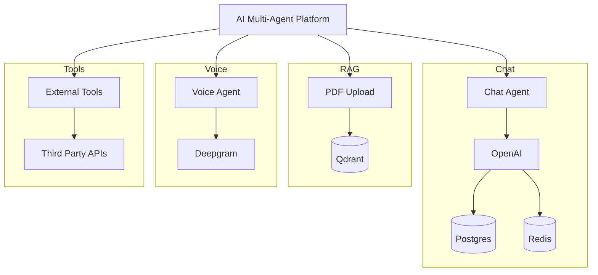

<div align="center">


<br/>

<a href="https://github.com/shivamkr082003/aroma-multiagent-platform/stargazers">
  
</a>

<a href="https://github.com/shivamkr082003/aroma-multiagent-platform/network/members">
  
</a>

<a href="https://github.com/shivamkr082003/aroma-multiagent-platform/issues">
  
</a>


<br/><br/>


</div>

---

# 🧠 Aroma Multi-Agent Platform

**Aroma Multi-Agent Platform** is a production-ready AI platform that combines multiple intelligent agents into a single application. It supports conversational AI, Retrieval-Augmented Generation (RAG), semantic vector search, voice interaction, Redis caching, and external tool integrations.

The project is designed with a modular architecture, making it easy to extend with new AI agents and tools.

---

# ✨ Features

* 🤖 Multi-Agent AI Architecture
* 💬 GPT-powered Conversational Assistant
* 📄 PDF Chat using Retrieval-Augmented Generation (RAG)
* 🔍 Semantic Search with Qdrant
* 🎤 Voice Interaction using Deepgram
* ⚡ Redis Caching
* 🗄️ PostgreSQL Database
* 🛠️ External API Integrations
* 🐳 Docker Support
* 🚀 FastAPI Backend
* 🔒 Scalable & Production Ready

---

# 🖼️ Preview

<div align="center">


</div>

---

# 🏗️ System Architecture



---

# 🛠️ Tech Stack

* Python
* FastAPI
* TypeScript
* PostgreSQL
* Redis
* Qdrant
* Docker
* OpenAI API
* Deepgram API

---

# 📂 Project Structure

```text
aroma-multiagent-platform/

├── Agent/
├── alembic/
├── crud/
├── docker/
├── frontend/
├── models/
├── create_tables.py
├── db.py
├── main.py
├── redis_client.py
├── requirements.txt
└── README.md
```

---

# 🚀 Getting Started

## Clone Repository

```bash
git clone https://github.com/shivamkr082003/aroma-multiagent-platform.git

cd aroma-multiagent-platform
```

---

## Backend Setup

```bash
python -m venv venv

source venv/bin/activate

pip install -r requirements.txt

python create_tables.py

uvicorn main:app --reload
```

---

## Frontend Setup

```bash
cd frontend

npm install

npm run dev
```

---

## Docker

```bash
cd docker

docker-compose up --build
```

---

# ⚙️ Environment Variables

```env
OPENAI_API_KEY=

DEEPGRAM_API_KEY=

DATABASE_URL=

REDIS_URL=

QDRANT_URL=
```

---

# 📈 Roadmap

* ✅ Multi-Agent Architecture
* ✅ GPT Chat
* ✅ Voice Assistant
* ✅ PDF Chat
* ✅ RAG Pipeline
* ✅ Redis Cache
* ⏳ Multi-Document Memory
* ⏳ Authentication
* ⏳ Team Collaboration
* ⏳ Cloud Deployment

---

# 🤝 Contributing

Contributions are welcome.

1. Fork the repository.
2. Create your feature branch.
3. Commit your changes.
4. Push your branch.
5. Open a Pull Request.


---

<div align="center">

## ⭐ Star this repository if you found it useful!

### Developed by **Shivam Kumar**


</div>